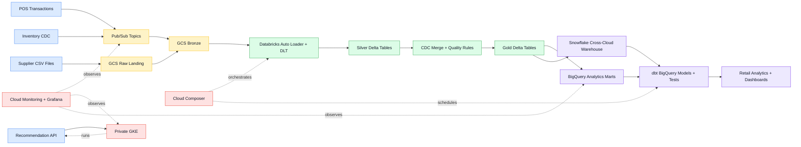
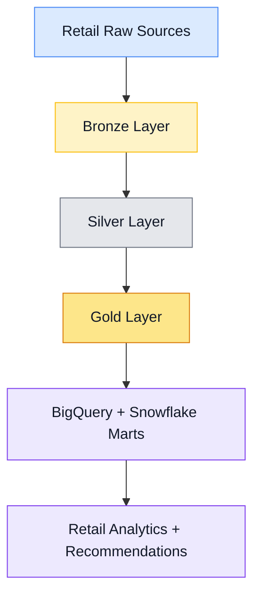

<div align="center">

# Enterprise Retail Lakehouse Platform on GCP

### Production-oriented multi-region retail analytics platform using GCP, Databricks, Delta Lake, BigQuery, Snowflake, dbt, GKE, Cloud Composer, Terraform, Grafana, and GitHub Actions.


</div>

---

## Project Overview

**Enterprise Retail Lakehouse Platform on GCP** is a production-oriented reference implementation for a multi-region retail analytics platform.

The platform demonstrates how retail data can be ingested, processed, modeled, governed, monitored, and deployed across a modern cloud lakehouse architecture. It covers raw ingestion, Cloud Storage lake zones, Pub/Sub messaging, Delta Lake processing, BigQuery and Snowflake marts, Kubernetes workloads on GKE, Cloud Composer orchestration, Cloud Monitoring dashboards, Grafana dashboards, and GitHub Actions deployment workflows.

This repository is designed like a real enterprise platform project, not a small demo. It includes infrastructure, orchestration, batch and streaming pipelines, analytics models, security controls, monitoring assets, deployment workflows, tests, and runbooks.

---

## Business Use Cases

This platform supports retail analytics use cases such as:

- Daily sales analytics
- Inventory forecasting features
- Customer recommendation features
- Supply chain KPI reporting
- Product performance tracking
- Store-level analytics
- Cross-cloud warehouse reporting
- Operational monitoring and smoke checks
- Batch and streaming retail data processing
- Production-style lakehouse deployment on GCP

---

## What This Deploys

| Layer | Implementation |
|---|---|
| GCP Foundation | APIs, VPC, regional subnets, Cloud NAT, KMS, Secret Manager, audit logging |
| Storage Layer | Cloud Storage lake zones for Bronze, Silver, and Gold data |
| Streaming Layer | Pub/Sub topics, subscriptions, retry policies, dead-letter topics |
| Warehouse Layer | BigQuery datasets, tables, materialized views, and Snowflake warehouse setup |
| Compute Layer | Private GKE cluster, ETL microservice, recommendation API, SparkApplication examples |
| Lakehouse Layer | Databricks Auto Loader, Structured Streaming, Delta Live Tables, CDC merge logic |
| Transformation Layer | dbt BigQuery marts, tests, models, and analytics-ready tables |
| Orchestration Layer | Cloud Composer environment and Airflow DAGs |
| Operations Layer | Cloud Monitoring dashboards, Grafana dashboards, retry scripts, smoke checks |
| Deployment Layer | GitHub Actions CI/CD workflows and environment-based deployments |
| Security Layer | KMS, Secret Manager, Workload Identity Federation, private GKE, audit logging |

---

## Architecture



---

## Medallion Lakehouse Flow



---

## Repository Map

```text
terraform/          GCP infrastructure modules and dev/prod environments
docker/             ETL and recommendation API containers
kubernetes/         Kustomize manifests for GKE workloads
airflow/            Composer DAGs and shared orchestration helpers
databricks/         Auto Loader, DLT, CDC, and job definitions
spark/              Spark jobs deployable through Spark Operator or Databricks
dbt/                BigQuery marts and tests
snowflake/          Cross-cloud warehouse setup
informatica/        Enterprise ETL mapping specs and parameter files
monitoring/         Grafana and Cloud Monitoring assets
scripts/            Bootstrap, validation, deployment, smoke checks
tests/              Static, schema, and contract tests
docs/               Architecture, deployment, security, operations
.github/workflows/  CI/CD validation and deployment workflows
```

---

## Technology Stack

| Area | Technologies |
|---|---|
| Cloud Platform | Google Cloud Platform |
| Infrastructure | Terraform |
| Storage | Cloud Storage |
| Streaming | Pub/Sub |
| Warehouse | BigQuery, Snowflake |
| Lakehouse | Databricks, Delta Lake, Auto Loader, DLT |
| Processing | Spark, Structured Streaming |
| Transformation | dbt |
| Orchestration | Cloud Composer, Airflow |
| Containers | Docker |
| Runtime | GKE, Kubernetes |
| Monitoring | Cloud Monitoring, Grafana |
| CI/CD | GitHub Actions |
| Security | KMS, Secret Manager, Workload Identity Federation, audit logging |

---

## Fast Path

### 1. Create GCP Project

Create or select a GCP project with billing enabled.

### 2. Create Terraform State Bucket

```bash
./scripts/bootstrap_state_bucket.sh "$PROJECT_ID" "$REGION" "$PREFIX-tfstate"
```

### 3. Configure Terraform Variables

Copy the example tfvars file:

```bash
cp terraform/envs/dev/terraform.tfvars.example terraform/envs/dev/terraform.tfvars
```

Then fill in your real project, repository, region, and environment values.

### 4. Deploy Infrastructure

```bash
terraform -chdir=terraform/envs/dev init -backend-config="bucket=$PREFIX-tfstate"
terraform -chdir=terraform/envs/dev plan -out=tfplan
terraform -chdir=terraform/envs/dev apply tfplan
```

### 5. Configure GitHub Actions

Add Terraform outputs as GitHub environment variables and secrets.

Then run:

```text
.github/workflows/deploy.yml
```

---

## Deployment Order

```text
1. terraform apply
2. Build and push containers to Artifact Registry
3. Deploy Kubernetes workloads to GKE
4. Sync Airflow DAGs to Composer
5. Deploy Databricks jobs and pipelines
6. Run dbt deps and dbt build
7. Apply Snowflake SQL and Terraform
8. Run smoke checks and publish SLO dashboards
```

---

## Real Environment Notes

- GitHub Actions uses Workload Identity Federation, not service-account keys.
- GKE workloads use Workload Identity Federation for GKE through annotated Kubernetes service accounts.
- Buckets are encrypted with customer-managed KMS keys.
- Cloud Storage uses uniform bucket-level access.
- Pub/Sub subscriptions include dead-letter topics and retry settings.
- BigQuery tables are partitioned and clustered.
- Reporting uses BigQuery materialized views where useful.
- Databricks Auto Loader includes schema locations, rescued data, and schema evolution settings.
- The repo does not hard-code project IDs, account IDs, Databricks workspace, Snowflake account, or Informatica tenant.

---

## Security Baseline

This project includes production-style security patterns:

- KMS encryption
- Secret Manager usage
- Workload Identity Federation for GitHub Actions
- Workload Identity Federation for GKE workloads
- Private GKE cluster design
- Audit logging
- Least-privilege access patterns
- Parameterized project and tenant values
- No hard-coded credentials
- Environment-specific Terraform variables

---

## Validation

Run validation before opening a pull request:

```bash
make validate
```

Run smoke checks after deployment:

```bash
make smoke
```

---

## Example Analytics Outputs

| Model | Purpose |
|---|---|
| `fct_daily_sales` | Daily sales fact table |
| `customer_recommendations` | Recommendation feature output |
| `fct_inventory_forecast_features` | Inventory forecasting features |
| `supply_chain_kpis` | Supply chain performance metrics |

---

## Why This Project Matters

This project demonstrates practical data engineering and platform engineering skills:

- Building a production-style retail lakehouse on GCP
- Designing multi-region cloud data platforms
- Using Pub/Sub for event-driven ingestion
- Processing data with Databricks, Spark, Delta Lake, Auto Loader, and DLT
- Modeling analytics data with dbt and BigQuery
- Integrating Snowflake for cross-cloud warehouse reporting
- Deploying APIs and services on GKE
- Automating infrastructure with Terraform
- Orchestrating workloads with Cloud Composer and Airflow
- Creating monitoring and operational dashboards
- Applying security-first deployment patterns
- Building CI/CD workflows with GitHub Actions

---

## Author

**Sujoy Halder**  
GCP | Data Engineering | BigQuery | Databricks | Delta Lake | dbt | Snowflake | GKE | Terraform | CI/CD

<div align="center">

### Built for production-style retail data engineering on Google Cloud


</div>
