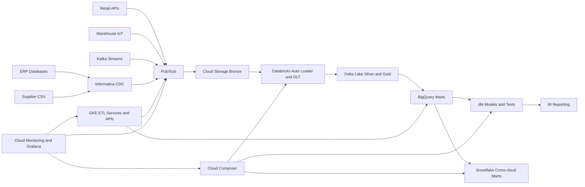

# Architecture

## Platform Flow

## Layers

Bronze stores replayable raw records in Cloud Storage and Delta tables. Silver applies schema enforcement, deduplication, CDC, and enrichment. Gold exposes business marts for sales analytics, inventory forecasting, customer analytics, and supply-chain KPIs.

## Runtime Ownership

- Terraform owns GCP foundations and IAM.
- Kubernetes owns runtime services and SparkApplication specs.
- Databricks owns Auto Loader, DLT, and Delta CDC logic.
- dbt owns BigQuery transformations and data quality tests.
- Snowflake owns cross-cloud marts and executive views.
- Composer owns recurring orchestration.
- GitHub Actions owns deployment ordering and gates.

